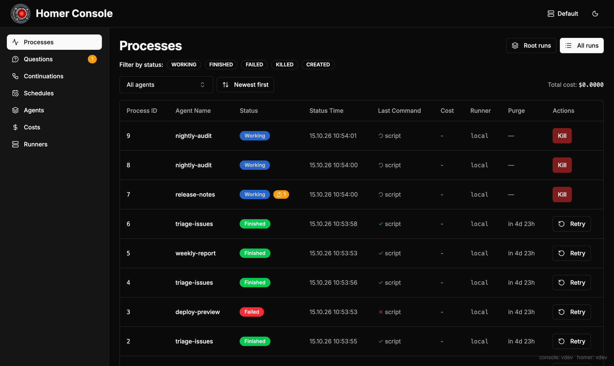
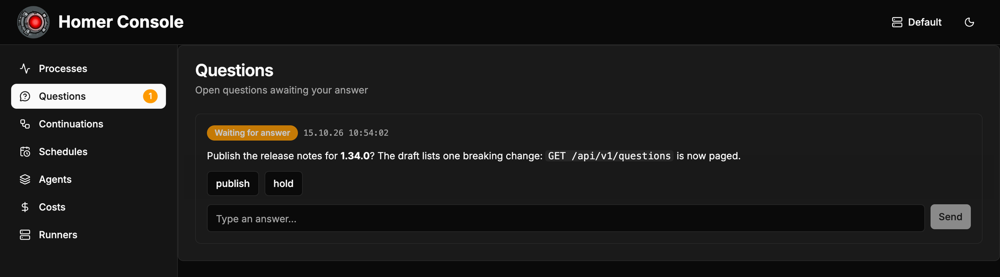
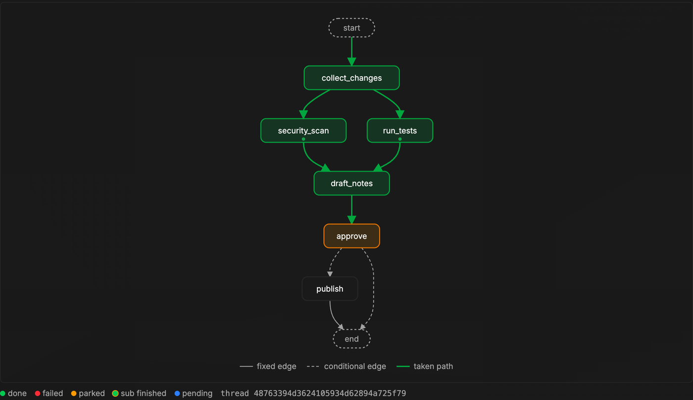

<p align="center">
  
</p>

<h1 align="center">Homer</h1>

<p align="center">
  <b>Homer watches your agents, so you don't have to.</b><br>
  Run Claude Code, Codex, LangGraph and plain old shell scripts as background jobs —<br>
  with queues, locks, spend caps, and a human on call when it matters.
</p>

<p align="center">
  <a href="https://github.com/livesport/homer/actions/workflows/ci.yml"></a>
  <a href="https://github.com/livesport/homer/releases"></a>
  <a href="LICENSE"></a>
</p>

<p align="center">
  <a href="#show-me">Show me</a> ·
  <a href="#quick-start">Quick start</a> ·
  <a href="https://livesport.github.io/homer/atlas/">Feature atlas</a> ·
  <a href="https://livesport.github.io/homer/">Documentation</a>
</p>

---

## Why Homer?

Starting a coding agent is one command. Running fifty of them unattended is a
different job: someone has to queue them, stop two from editing the same
checkout, notice when one burns through the budget, answer its question at
2 a.m., and tell you afterwards what happened.

Homer is that someone. You describe an **agent** — a list of steps in an
`agent.yaml` — and trigger it over HTTP, on a cron schedule, or as an MCP tool.
Homer runs it in the background in its own workspace, keeps the logs,
artifacts and costs, and traces every step with OpenTelemetry.

*(The name stands for **H**ub for **O**rchestrating **M**anaged **E**xecution
**R**uns. The red eye in the logo is keeping an eye on things. Nothing more
sinister, we promise.)*

## Show me

An agent that hunts down a flaky test, lets Claude fix it, and asks before
pushing:

```yaml
name: fix-flaky-test
description: Reproduces a flaky test, lets Claude fix it, asks before pushing
inputs:
  - paramName: test
    envName: TEST
    type: string
    required: true
lockStrategy:
  key: "repo"           # one run at a time touches the checkout
  onCollision: WAIT
commands:
  - !<script>
    content: ./gradlew test --tests "$TEST" --rerun 2>&1 | tail -50
    continueIfFail: true
    resultEnvParam:
      - src: STD_OUT
        envName: FAILURE_LOG
  - !<claude>
    prompt: !<prompt>
      prompt: |
        {{TEST}} is flaky. Its last run printed:
        {{FAILURE_LOG}}
        Find the cause and fix it. Commit, but don't push.
    timeout: 1800          # seconds
    options:
      model: sonnet
      maxBudgetUsd: 2.0    # Claude stops here, not your card
  - !<script>
    timeout: 86400         # waits for a human, so give it a day
    content: |
      answer=$(homer-ask ask-and-wait "Push the fix for **$TEST**?" --option push --option drop)
      if [ "$answer" = push ]; then git push; fi
```

Start it and walk away:

```bash
curl -X POST -H "Authorization: Bearer $TOKEN" \
  "http://localhost:8080/api/v1/agent/fix-flaky-test?test=OrderServiceTest"
# {"processId": 42}
```

Then watch it in the web console: live logs, every run's status, what each one
cost, and the question waiting for your answer.

<p align="center">
  
</p>

When an agent needs a human, the question lands in the console's inbox. Click
an answer, and the run picks up where it left off:

<p align="center">
  
</p>

### Durable workflows with LangGraph

When a list of steps isn't enough, write the flow as a
[LangGraph](https://www.langchain.com/langgraph) graph and run it with
`!<langgraph>`. Homer checkpoints every step, runs branches as sub-agents in
parallel, and parks the graph on a human question without keeping anything
running — when the answer arrives, the graph resumes from its checkpoint, right
where it stopped.

```python
def run_tests(state):   # a Homer sub-agent, running in parallel with security_scan
    return {"tests": homer_fanout("run-tests", result_jsonpath="$.summary", group="checks")}

def approve(state):     # parks the graph until the operator answers
    return {"decision": homer_interrupt("Ship **1.34.0**?", options=["ship it", "hold"])}
```

The console draws the graph and shows how far each run got. Green is the path
taken — the two checks ran side by side as sub-agents — and orange is where the
run waits for the operator:

<p align="center">
  
</p>

## What's in the box

- **Async HTTP API** — a run call returns a process id at once; follow the run
  through status, SSE streams, or the web console.
- **Seven command types** — `!<cmd>`, `!<script>`, `!<claude>`, `!<codex>`,
  `!<agent>` (nested agent), `!<langgraph>` (durable Python workflows with
  resume), and `!<runnerCmd>` (run one step on another runner).
- **Data flow between steps** — capture stdout, stderr or files into env vars
  (JSONPath, regex), template them with `{{VAR}}`, and gate steps with `when`.
- **Runs anywhere** — locally, on ssh hosts, as Kubernetes pods, or on
  pull-mode runners (`homer-runner`), with tag-based routing and per-runner
  concurrency.
- **Guardrails** — lock strategies, parallel-run caps, cooldowns, cron
  schedules, and LLM spend caps with a persistent cost ledger.
- **Human in the loop** — agents ask the operator and wait for the answer, or
  fire a follow-up agent once it arrives.
- **MCP server** — expose opted-in agents as MCP tools.
- **Auth and grants** — bearer, HMAC, and password auth, with per-agent
  `run` / `read` / `control` / `edit` / `debug` grants.
- **Observability** — OpenTelemetry traces, Langfuse integration, and
  Langfuse-managed prompts.
- **Web console** — processes, live logs, questions inbox, costs, and an
  agent editor.

## How it fits together

<!-- Rendered from docs/assets/architecture.mmd; when it changes, regenerate both SVGs from the repo root:
     docker run --rm -u "$(id -u):$(id -g)" -v "$PWD/docs/assets:/data" minlag/mermaid-cli:11.17.0 -i /data/architecture.mmd -o /data/architecture-light.svg -t default -b transparent
     docker run --rm -u "$(id -u):$(id -g)" -v "$PWD/docs/assets:/data" minlag/mermaid-cli:11.17.0 -i /data/architecture.mmd -o /data/architecture-dark.svg -t dark -b transparent -->
<p align="center">
  <picture>
    <source media="(prefers-color-scheme: dark)" srcset="docs/assets/architecture-dark.svg">
    
  </picture>
</p>

## When Homer is the right tool

**Reach for Homer** when you run coding agents, scripts or LangGraph workflows
on demand or on a schedule, and they need queueing, locking, spend limits, a
human answer mid-run, durable resume, or one API in front of several kinds of
machines.

**Reach for something else** when:

- one cron line on one box does the job — keep it, cron is great;
- you need data pipelines with backfills and DAGs — Airflow or Dagster;
- you want a sandbox that contains hostile code on its own — Homer leaves
  isolation to the runner you send a run to (see below).

## Quick start

Requires Docker with Compose.

```bash
cp .env.example .env

# Generate a strong admin API token (required — startup fails if it is empty)
echo "HOMER_ADMIN_TOKEN=$(openssl rand -hex 24)" >> .env

docker compose up -d
# Console: http://localhost:3000   API: http://localhost:8080 (both bound to 127.0.0.1)
```

Run the bundled `hello` example agent and check on it:

```bash
TOKEN=$(grep '^HOMER_ADMIN_TOKEN=.' .env | tail -n 1 | cut -d= -f2-)

curl -X POST -H "Authorization: Bearer $TOKEN" \
  "http://localhost:8080/api/v1/agent/hello?project_id=demo"
# {"processId": 1}

curl -H "Authorization: Bearer $TOKEN" "http://localhost:8080/api/v1/status/1"
```

The last step of `hello` calls the Claude CLI. That step fails until Claude
credentials reach the command environment
([`app/SERVER.md`](app/SERVER.md) § *Global Environment Variables*). Agents
built only from `!<cmd>` and `!<script>` steps need no LLM at all.

To run without Docker, build and start the server JAR as described in
[`app/README.md`](app/README.md). Use [`DOCKER.md`](DOCKER.md) for dev and
prod compose overrides, volumes, and image build options.

## Security model

Homer itself is **not a sandbox**: on the built-in `local` runner an agent
runs with the full access of the OS user Homer runs as. Isolation comes from
where a run executes, and each agent picks that with `runner:`. On the
`kubernetes` runner every run gets a pod of its own, bounded by its image,
resources and network policy. A `homer-runner` instance runs agents in a
container or VM away from Homer's host, as the runner's own unprivileged
user; on Linux the runner marks itself non-dumpable, so a run cannot read its
token ([ADR-0078](docs/adr/0078-runner-jvm-is-non-dumpable.md)). Runs on one
instance share that machine and that user, so give untrusted work an instance
of its own. Either way, treat what an agent runs,
and anything it writes, as untrusted, and give it only the files, network and
credentials it needs. The case study
[Runs that hold no credentials](docs/case-studies/credential-proxy.md) shows
runs that hold no token at all.

Homer does enforce boundaries between callers — every caller authenticates, grants decide which
agents they may run, read, control, edit or debug, and a run is visible only to
its owner, admins, and `read` grant holders. The Docker stack binds to
`127.0.0.1`; before anyone else can reach it, hand out narrow tokens and put a
TLS-terminating reverse proxy in front. Details:
[`app/SERVER.md`](app/SERVER.md) § *Authentication Configuration*, the
[threat model](docs/adr/0047-security-by-design-and-threat-model.md), and
[`SECURITY.md`](SECURITY.md) to report a vulnerability.

## Documentation

| Topic | Document |
| --- | --- |
| Everything below as one searchable site, per release | [livesport.github.io/homer](https://livesport.github.io/homer/) |
| Guided tour of every feature | [Feature atlas](https://livesport.github.io/homer/atlas/) (source: [`docs/homer-feature-atlas.html`](docs/homer-feature-atlas.html)) |
| Agent definition format | [`app/AGENT.md`](app/AGENT.md) |
| Server configuration | [`app/SERVER.md`](app/SERVER.md) |
| HTTP API, MCP server, building the backend | [`app/README.md`](app/README.md) |
| Docker deployment | [`DOCKER.md`](DOCKER.md) |
| Web console | [`console/README.md`](console/README.md) |
| Debugging agents locally (`agentdebug`) | [`DEBUG.md`](DEBUG.md) |
| LangGraph Python runtime | [`clients/python/homer_langgraph/README.md`](clients/python/homer_langgraph/README.md) |
| How Homer is run in practice | [Case studies](docs/case-studies/README.md) |
| Architecture decisions | [`docs/adr/`](docs/adr/README.md) |
| Release notes | [`CHANGELOG.md`](CHANGELOG.md) |

<details>
<summary><b>Editor autocomplete for <code>agent.yaml</code> and <code>config.yaml</code></b></summary>

JSON Schemas for the config file and agent definitions live in [`app/schemas/`](app/schemas/):

- [`app/schemas/homer-config.schema.json`](app/schemas/homer-config.schema.json) — for `config.json`/`config.yaml`
- [`app/schemas/homer-agent.schema.json`](app/schemas/homer-agent.schema.json) — for `agent.json`/`agent.yaml`

**VS Code**

Install the YAML extension (Red Hat) and add to `.vscode/settings.json`:

```jsonc
{
  "json.schemas": [
    { "fileMatch": ["**/config*.json"], "url": "./app/schemas/homer-config.schema.json" },
    { "fileMatch": ["**/agent.json"],   "url": "./app/schemas/homer-agent.schema.json" }
  ],
  "yaml.schemas": {
    "./app/schemas/homer-config.schema.json": ["**/config*.yaml", "**/config*.yml"],
    "./app/schemas/homer-agent.schema.json":  ["**/agent.yaml", "**/agent.yml"]
  },
  "yaml.customTags": [
    "!<cmd> mapping", "!<script> mapping", "!<claude> mapping", "!<codex> mapping",
    "!<langgraph> mapping", "!<runnerCmd> mapping", "!<agent> mapping",
    "!<pass>", "!<pass> mapping", "!<jsonPath> mapping", "!<regex> mapping",
    "!<prompt> mapping", "!<langfuse> mapping",
    "!<bearer> mapping", "!<hmac> mapping", "!<password> mapping", "!<combined> mapping",
    "!<unsecured>", "!<unsecured> mapping", "!<kubernetes> mapping", "!<ssh> mapping", "!<external> mapping", "!<key> mapping",
    "!<hostPath> mapping", "!<configMap> mapping", "!<secret> mapping", "!<pvc> mapping",
    "!<emptyDir>", "!<emptyDir> mapping"
  ]
}
```

You need `yaml.customTags` because kaml uses YAML tags to pick sealed-class
variants (e.g. `!<script>` selects `Command.Script`). If the tags aren't
registered, the YAML extension reports "unknown tag" errors.

**Inline directive**

Alternatively, add a `# yaml-language-server:` directive at the top of any YAML file:

```yaml
# yaml-language-server: $schema=../../../app/schemas/homer-agent.schema.json
name: hello
# ...
```

**JetBrains IDEs**

`File → Settings → Languages & Frameworks → Schemas and DTDs → JSON Schema Mappings`,
then add two mappings pointing at the files under `app/schemas/`.

</details>

<details>
<summary><b>Authoring agents with Claude Code</b></summary>

This repo doubles as a Claude Code plugin marketplace. The `homer-authoring`
plugin bundles a skill that teaches Claude the agent format plus copies of
both JSON schemas and `AGENT.md` for editor autocomplete. Install it from a
Claude Code session:

```
/plugin marketplace add https://github.com/livesport/homer.git
/plugin install homer-authoring@homer
```

The `.git` suffix makes Claude Code clone the repo instead of attempting a
marketplace-name lookup. An SSH remote
(`git@github.com:livesport/homer.git`) works too. Run
`/plugin marketplace update homer` to refresh after the format changes (the
bundled skill and schema ride in the same release as the format).

</details>

## Repository layout

- `app/` — backend (Kotlin/Ktor), its Dockerfile, JSON schemas, and the
  `agentdebug` CLI
- `console/` — web console (Next.js) and its Dockerfile
- `clients/` — Python `homer_langgraph` runtime behind `!<langgraph>`
- `example/` — example config and agents for the compose stack, plus example
  console plugins
- `docs/` — ADRs and the feature atlas
- `site/` — VitePress documentation site: `.vitepress/` config and theme,
  `pages/`, and the `scripts/` that assemble the published docs and schemas
- `tools/` — repository tooling: the PR policy check (`pr-policy/`) and the
  quality gates (`quality/`)
- `plugins/`, `.claude-plugin/` — the `homer-authoring` Claude Code plugin and
  its marketplace manifest

## Contributing

Contributions are welcome! [`CONTRIBUTING.md`](CONTRIBUTING.md) covers the
toolchain (JDK 25 for the backend, Node for the console), the verify commands,
and the commit, changelog and ADR conventions. Everyone taking part follows the
[Code of Conduct](CODE_OF_CONDUCT.md). The people behind Homer are in
[`CONTRIBUTORS.md`](CONTRIBUTORS.md).

## License

Licensed under the [Apache License, Version 2.0](LICENSE). Copyright 2026
Livesport s.r.o.

Homer redistributes third-party code in its JARs and Docker images:
[`NOTICE`](NOTICE) carries the attributions those dependencies require, and
[`THIRD-PARTY-LICENSES.md`](THIRD-PARTY-LICENSES.md) inventories every
redistributed package with its license.
